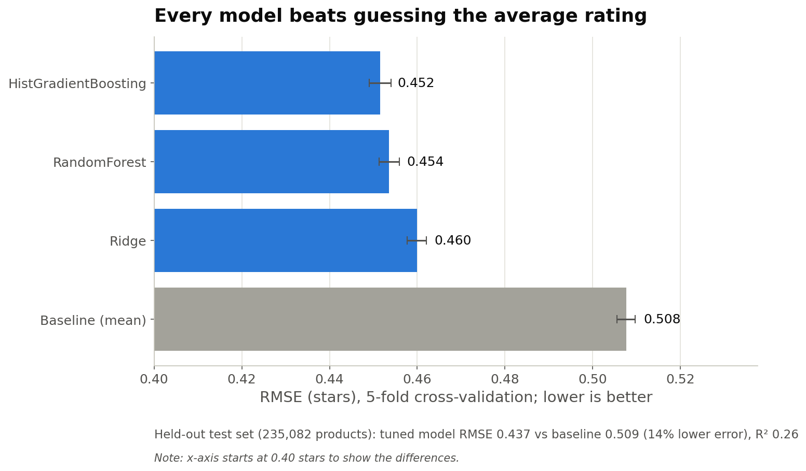
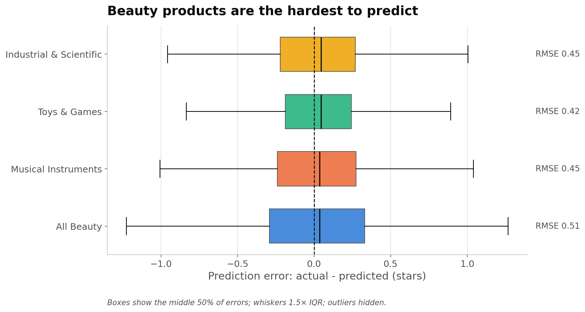
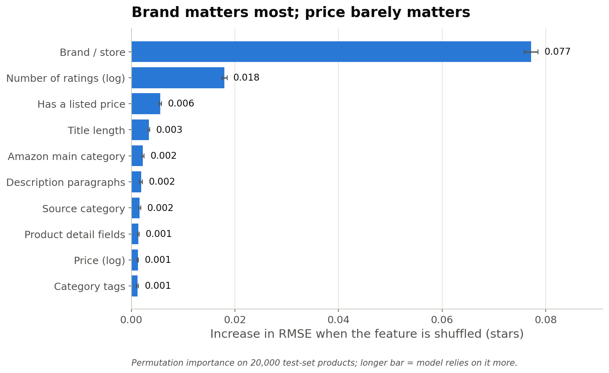

# Executive Summary Report

**Team Number:** 6  
**Date:** November 15, 2026  
**Subject:** What Drives Amazon Product Ratings: Predicting Customer Satisfaction from Listing Data

## Project Goal

Help sellers and category managers understand which listing characteristics go with higher customer ratings. We predicted a product's average star rating (1–5) from its listing (brand, price, review volume, category and listing content), measured how much of the rating these details explain, and identified which matter most.

## Major Findings

We analyzed 1,175,407 Amazon products with at least five ratings across four categories. Four regression models were compared with 5-fold cross-validation.

**Table 1. Model Performance Comparison (5-Fold CV)**

| Model | RMSE (stars) | R² | Selected |
|---|---|---|---|
| Baseline (predict mean) | 0.508 | 0.00 | No |
| Ridge regression | 0.460 | 0.18 | No |
| Random Forest | 0.454 | 0.20 | No |
| Gradient Boosting | 0.452 | 0.21 | Yes |

As shown in Table 1, gradient boosting performed best. After tuning, it was scored once on the held-out test set: RMSE 0.437 vs 0.509 for the baseline (14% lower error), MAE 0.321, R² 0.26.

Model comparison is illustrated in Figure 1. Listing details predict ratings, but only partly: most of what drives a rating, such as product quality, is not visible in the listing.

**Figure 1. Model Comparison (Cross-Validated RMSE)**

Ratings skew high (mean 4.27), so we report errors in stars against a predict-the-average baseline rather than accuracy.

Prediction error by category is summarized in Table 2 and visualized in Figure 2.

**Table 2. Test-Set Error by Category**

| Category | RMSE (stars) | Mean rating |
|---|---|---|
| All Beauty | 0.51 | 3.95 |
| Musical Instruments | 0.45 | 4.22 |
| Industrial & Scientific | 0.45 | 4.27 |
| Toys & Games | 0.42 | 4.32 |

All Beauty has the lowest ratings and the largest errors, so satisfaction there is least predictable. Errors are centered on zero in every category; low-rated products are overestimated.

**Figure 2. Prediction Error by Category**

Feature importance results are presented in Figure 3. Brand (store) is the strongest predictor (0.077-star error increase when shuffled), followed by rating volume (0.018). Price barely matters (0.001). More-reviewed products rate higher: 4.62 stars at 10,000+ ratings vs 4.11 at 1–9.

**Figure 3. Feature Importance (Top Predictors)**

## Recommendations

1. Sellers should invest in brand reputation and product quality rather than price cuts, which show almost no link to ratings.
2. Category managers should prioritize All Beauty, where ratings are lowest and least predictable.
3. Flag low-rated products through reviews and returns early, since listing data alone overestimates them.
4. Next, add review text, dates and verified-purchase data, and test category-specific models.

## Analytical Overview

Data came from the public Amazon Reviews 2023 metadata (McAuley Lab, UC San Diego): All Beauty, Musical Instruments, Industrial & Scientific, and Toys & Games. After cleaning, 1,644,621 products remained; we kept those with at least five ratings. Twelve features were engineered, including log price, log rating count, listing completeness and brand. Data were split 80/20 (940,325 training, 235,082 test), stratified by category. Preprocessing was fitted inside each cross-validation fold to prevent leakage. The best model was tuned with randomized search and scored once on the test set. The workflow is reproducible with one Conda environment (amazon-reviews-env.yml) and runs end to end with python -m src.pipeline.

## Risks and Limitations

Results show associations, not causes. The data are a 2023 snapshot of four categories, and Toys & Games makes up 59% of products. Ratings come from self-selected reviewers. Excluding products with fewer than five ratings (28.5% of listings) means new or niche products are not covered. About half of products list no price; these were imputed and flagged. The model fits training data better than test data (R² 0.39 vs 0.26), mostly through brand, and store names are not verified brands.
